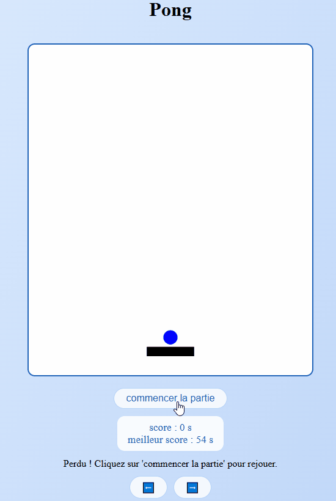

# Pong

Un Pong en solo, façon squash, en HTML5 canvas et JavaScript sans framework : une raquette, trois murs, et une balle qui accélère à chaque rebond. Le score est le temps tenu avant de la laisser passer.

**[▶️ Jouer en ligne](https://starkiou.github.io/pong/)**

## Fonctionnalités

- Balle qui accélère à chaque rebond, jusqu'à cinq fois sa vitesse de départ.
- Score en secondes tenues, meilleur score gardé dans le navigateur (`localStorage`).
- Commandes au clavier (flèches gauche et droite) ou par les boutons à l'écran, à la souris ou au doigt, en restant appuyé.

## Lancer en local

Aucune installation : cloner le dépôt et ouvrir `index.html` dans un navigateur.

## Ce que j'ai appris

- **Delta time** : les vitesses sont exprimées en pixels par seconde et multipliées par le temps écoulé entre deux images, pour que le jeu aille à la même vitesse sur un écran 60 Hz ou 240 Hz.
- **Boucle de jeu** : une seule boucle `requestAnimationFrame` met à jour, dessine et compte le score, et elle s'arrête réellement au game over.
- **Entrées** : l'état des touches est gardé dans une table lue à chaque image, plutôt que de dépendre de la répétition automatique du clavier.
- **Collisions** : un rebond ne compte que si la balle se dirige vers l'obstacle, et la raquette est testée sur tout le trajet parcouru depuis l'image précédente, pour qu'une balle rapide ne la traverse pas.

## Licence

[MIT](LICENSE)
